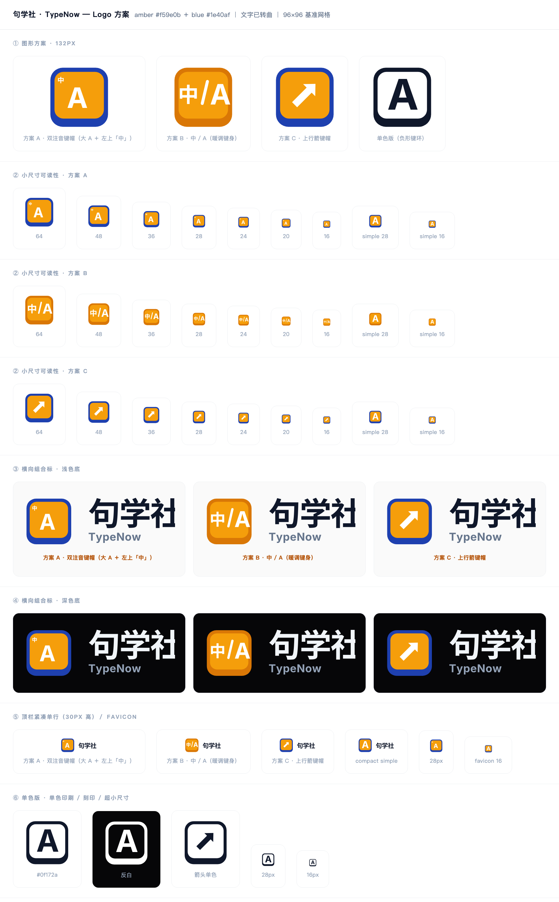

# 句学社 · TypeNow 品牌标识



> **2026-10-08 改名。** 本目录原为「码上英语」生成资产，品牌名改为**句学社**后已重跑
> `subset-fonts.py → build.py → preview.py → export-png.sh` 全部再生成一遍（新中文字形
> 「句学社」原来不在 5KB 子集字体里，必须先重跑子集化，否则会退到完整字体或报缺字）。
> 标头文案的单一来源是 `tools/build.py` 的 `CJK_TEXT, LATIN_TEXT`；`aria-label` / `<title>`
> 也从同一处取值，改名时不会漏掉无障碍文案。

## 概念

**键帽 ＋ 双注音。**

产品做的是「中译英打字」，所以标识的主形是一枚键帽 —— 打字练习的唯一实体隐喻。
键面里是**双注音**：居中主图例是大写 **A**，左上角副图例是 **中**。

这不是随手拼的两个字：真实键盘上的双注音（日文键盘的假名、中文键盘的仓颉）就是
「一个按键上叠两种语言」的写法。用它做标识，等于把「中英同键、按一下换一种语言」
直接画了出来，跟产品在做的事完全对齐。

> 早期废弃方案记录（避免后人重走）：
> ① 「琥珀圆角方块 + 白色斜箭」—— 渲染出来读成分享按钮，键帽感为零；
> ② 「上宽下窄的梯形侧壁」做 2.5D 键帽 —— 读成火把／铲子；
> ③ 用几何拼装的「中」（方框＋竖笔）当副图例 —— 方框压扁后读成 φ。
> 最终形态是**两层同心圆角矩形**：外＝键身、内＝键面，底部内缩更多而形成正面壁。

## 三个方案

| 方案 | 键面 | 键身 | 特点 | 建议 |
|------|------|------|------|------|
| **A** | 大 A ＋ 左上「中」 | 深蓝 `#1e40af` | 双注音，同时用上站点两个色 token；小尺寸靠 simple 版兜底 | **推荐主用** |
| B | 中 ／ A | 暖琥珀 `#d97706` | 单色暖调，语义最直白；36px 以下偏挤 | 备选／暖色场景 |
| C | 45° 上行箭 | 深蓝 `#1e40af` | 最动态，寓意「码上」；语义最弱（没有中英对照） | 备选／营销物料 |

## 规范

### 网格

96×96 基准网格（`viewBox="0 0 96 96"`）：

| 部件 | x | y | 宽 | 高 | 圆角 |
|------|---|---|----|----|------|
| 键身 | 6 | 5 | 84 | 86 | 18 |
| 键面 | 12 | 11 | 72 | 68 | 13 |

键面上／左／右内缩 6，底部内缩 12 —— 这个不对称就是「键的正面壁」，去掉它键帽感会消失。

文字标：中文 em 56 / 字距 −0.03em，拉丁 em 25 / 字距 +0.02em，行距 11。
图标与文字间距 26（横排）／20（紧凑）。横排组合标成品 285×96（旧名「码上英语」是 4 个汉字、
成品 339.3×96；改成 3 字的「句学社」后窄了 54.3）

### 颜色

| 用途 | 值 | 来源 |
|------|-----|------|
| 键面 | `#f59e0b` | `globals.css` 的 `--primary` |
| 键身（冷） | `#1e40af` | `globals.css` 的 `--accent` |
| 键身（暖） | `#d97706` | 琥珀加深 |
| 中文标 / 深色底文字 | `#0f172a` / `#f1f5f9` | `--foreground` |
| 拉丁副标 | `#64748b` / `#94a3b8` | `--muted-foreground` |

### 最小尺寸（重要）

副图例「中」只有 13.5/96 大，**图标低于 36px 时会糊成一个白点**，看起来像脏东西而不是设计。
因此：

| 场景 | 用哪个文件 | 阈值 |
|------|-----------|------|
| 图标（带副图例） | `icon-a.svg` | ≥ 36px |
| 图标（去掉副图例） | `icon-a-simple.svg` | ≤ 32px |
| 单色／刻印／超小 | `icon-mono-ink.svg` | 任意，16px 仍清晰 |
| 横排组合标 | `logo-horizontal-a.svg` | 宽 ≥ 170px |
| 紧凑单行 | `logo-compact-a.svg` / `-simple` | 宽 ≥ 120px |

当前代码里顶栏是 30px、页脚 24px、登录页 38px —— 除登录页外都落在 simple 区间。

### 留白与禁止

- 图标画布内已留了约 5%（96 网格里 5–6）的边距；**使用时在此之外**再留 ≥ 图标高度 1/4
  的空白，不要贴到其它元素或容器边缘。
- 禁止：拉伸压扁、旋转、改配色、给键帽加描边或投影、把副图例「中」单独拿掉后当另一个图标用、
  在深色底上使用非 `-reverse` 版本。

## 文件清单

```
brand/
├── README.md              本文
├── preview.html           自包含对照看板（SVG 已内联为 data URI，双击即可打开）
├── preview.png            上面那张总览图
├── sizes.json             各组合标的 viewBox 尺寸
├── svg/                   ① 源文件，全部文字已转曲
│   ├── icon-{a,b,c}.svg               主图标 96×96
│   ├── icon-{a,b,c}-simple.svg        小尺寸版（去掉副图例）
│   ├── icon-mono-{ink,white,arrow}.svg 单色版，负形键环
│   ├── logo-horizontal-{a,b,c}.svg            横排组合标（浅色底）
│   ├── logo-horizontal-{a,b,c}-reverse.svg    横排组合标（深色底）
│   ├── logo-compact-{a,b,c}.svg               紧凑单行
│   └── logo-compact-{a,b,c}-simple.svg        紧凑单行 · 小尺寸版
├── png/                   ② 位图，全部带透明通道
│   ├── typenow-icon-{1024,512,180,108,32}.png
│   ├── typenow-icon-simple-{32,16}.png
│   ├── typenow-icon-mono-{512}.png / -mono-white-512.png
│   ├── typenow-logo-{1x,2x}.png / -reverse-2x.png
│   └── typenow-logo-compact-{2x}.png / -compact-simple-2x.png
└── tools/                 ③ 生成器（可复现，不是一次性产物）
    ├── outline.py         字体 → SVG path，按字符覆盖自动选字体
    ├── build.py           生成全部 SVG（改配色/几何只动这里）
    ├── subset-fonts.py    从 Google Fonts 切片生成 5KB 子集字体
    ├── nodebrotli.py      用 Node 内置 brotli 顶替装不上的 brotli 扩展
    ├── fetch-fonts.py     （可选）下载完整 OFL 字体，17MB，仅当标头改字后需要
    ├── export-png.sh      无头 Chrome 光栅化 + 生成 preview.png
    ├── preview.py         生成 preview.html
    └── fonts/             子集字体 ＋ OFL 许可证（完整字体被 .gitignore 排除）
```

## 字体与授权

**两个字族都是 SIL Open Font License 1.1，可商用、可修改、可嵌入。**

| 用途 | 字族 | 字重 |
|------|------|------|
| 中文标 句学社 ＋ 图标副图例 中 | Noto Sans SC | 700 |
| 拉丁标 TypeNow ＋ 图标主图例 A | Inter（与站点正文同族） | 700 |

三个处理，都是为了不把授权隐患留给以后：

1. **全部转曲。** SVG 里没有一个 `<text>`，所有文字都是 path，换机器、换平台、缺字体都不会变形。
2. **只vendor两个 5KB 子集字体。** 完整 Noto Sans SC 是 17MB、Inter 0.9MB，而这个 logo 一共
   只用 12 个字形。`subset-fonts.py` 走 Google Fonts 的 unicode-range 切片，把用到的字抠出来
   做成 `tools/fonts/TypeNowLogoCJK.ttf`（2.9KB）和 `TypeNowLogoLatin.ttf`（2.6KB）。
   两个小文件跟着仓库走，**构建完全不需要联网**。OFL 许可证原文一并放在 `tools/fonts/OFL-*.txt`。
3. **按 OFL 要求改名。** Noto Sans SC 派生自 Adobe 的 Source Han Sans，其 OFL 声明了保留字体名
   `Source`；OFL 规定「修改版不得使用保留名」，所以子集字体的 family 改成了 `TypeNowLogoCJK` /
   `TypeNowLogoLatin`，而 copyright / license / licenseURL 三个字段原样保留（OFL 同时要求随附）。

`outline.py` 按「**哪个候选字体覆盖了本次要用到的全部字符**」来选，顺序是：
子集字体 → 完整字体（`fetch-fonts.py`）→ `.next` 里的 Inter 子集 → macOS 苹方（仅兜底预览）。
所以改了标头文案、子集里没有那个字时，它会自动退到完整字体并打印缺字告警，不会静默出错字。

> ⚠️ 最后一级回退到的是 macOS 苹方（Hiragino Sans GB W6）。**那一版不要对外发布** ——
> 系统字体的字形授权不允许这样用，它只用于本地快速预览。

## 接进现有代码

当前仓库用的是从 iconfont 借来的「剪贴板」图标：`public/logo.svg`（`#13227a`）。
四个引用点全都指向它：

| 文件 | 行 | 尺寸 |
|------|----|------|
| [src/components/home/HomeTopbar.tsx](../src/components/home/HomeTopbar.tsx#L13) | 13 | 30 |
| [src/components/layout/Navbar.tsx](../src/components/layout/Navbar.tsx#L74) | 74 | 26 |
| [src/components/layout/Footer.tsx](../src/components/layout/Footer.tsx#L45) | 45 | 24 |
| [src/app/login/page.tsx](../src/app/login/page.tsx#L33) | 33 | 40 |

替换步骤（**尚未执行，等确认后再动线上素材**）：

```bash
cp brand/svg/icon-a-simple.svg public/logo.svg        # 现 24/26/30/40px 都在 simple 区间
cp brand/png/typenow-icon-32.png public/favicon.ico   # 或换 src/app/favicon.ico
```

注意两点：

1. **不再需要深色变体。** 早先有 `public/logo.svg` ＋ `public/logo_w.svg` 深浅两版，
   由 `HomeTopbar.tsx` 的 `[.dark_&]` 切换；暗色主题已在 2026-10 整套删除，
   `logo_w.svg` 随之删除（全仓已无引用）。新图标自身带深蓝键身，在白底上也成立，
   因此单个 `logo.svg` 就够 —— 但替换后**不要再**把 `logo_w.svg` 引回来。
2. 顶栏 30px 用的是 simple 版；若希望顶栏显示带「中」副图例的完整版，需把尺寸提到 ≥36px
   并同步调整 `HomeTopbar.tsx` 的布局。

## 重新生成

```bash
# 子集字体已在仓库里，下面这步通常不需要；改了标头文案才要重跑
python3 brand/tools/subset-fonts.py    # 生成 tools/fonts/*.ttf（联网，约 130KB 切片）

python3 brand/tools/build.py           # 生成 brand/svg/*
python3 brand/tools/preview.py         # 生成 brand/preview.html
bash    brand/tools/export-png.sh      # 生成 brand/png/* 和 preview.png（需本机 Chrome）
```

改配色只动 `build.py` 顶部的 `AMBER / BLUE / ...`；改几何动 `BODY / FACE` 两个元组；
改标头文案动 `CJK_TEXT / LATIN_TEXT`（字符集 `CJK_CHARS / LATIN_CHARS` 会自动跟着变，
`subset-fonts.py` 也读同一处，不会出现两处不一致）。

`subset-fonts.py` 依赖 Node（借它的 brotli 解压切片，见 `nodebrotli.py`）。
若本机已有 brotli 扩展，垫片会自动让位。

## 验收记录

- 21 个 SVG：XML 全部合法，无 `<text>` / `font-family`，即不依赖任何字体
- 14 张 PNG：格式完整（IEND 校验通过），RGBA 透明通道正常
- 子集字体：OFL 保留名已去除，copyright/license 字段保留，OFL 原文随仓库
- 构建链：`subset-fonts.py → build.py → preview.py → export-png.sh` 全部跑通
- 可复现：重跑 `build.py` 后 21 个 SVG 的 SHA-256 与重跑前完全一致（0 个差异）
- 6 个 Python 脚本 + 1 个 shell 脚本语法检查通过（用内存编译，避开沙箱外的 .pyc 缓存）
